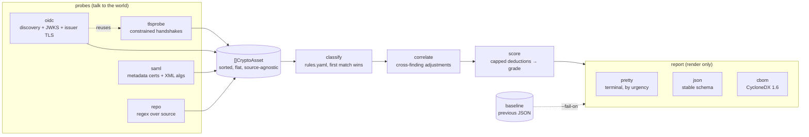
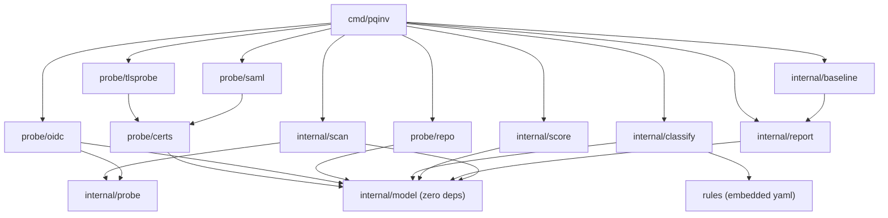
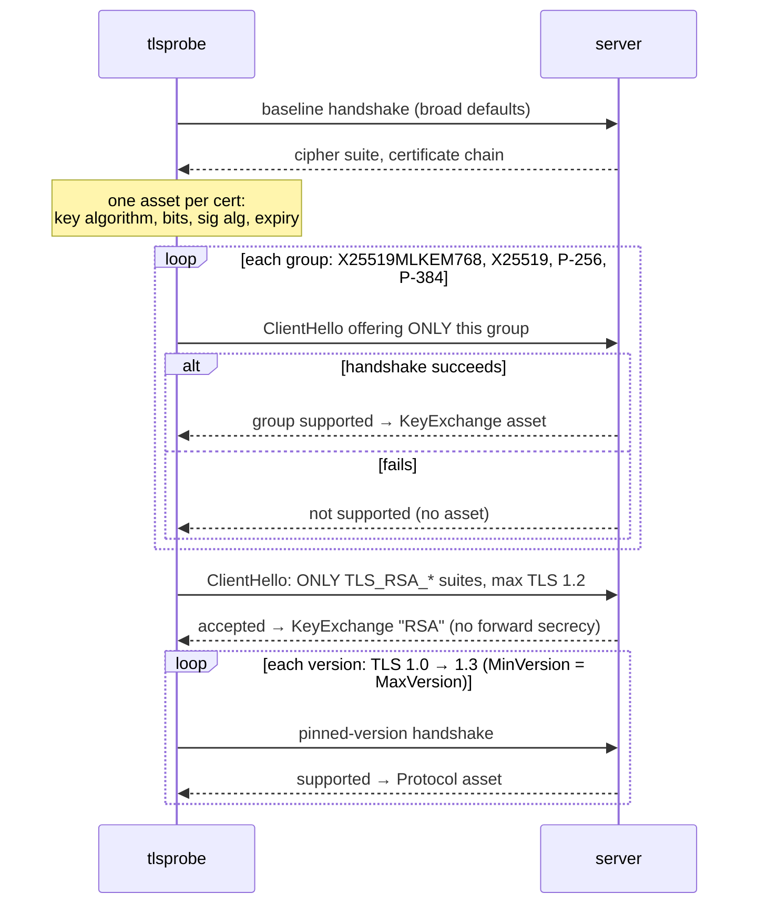

# pqinv architecture

*As built — kept current with each release (last: v0.3.0, October 2026). Where the code and this document disagree, the code is the truth and this document gets fixed.*

pqinv is an identity-first Go CLI that inventories the cryptography a system actually uses — OIDC/JWKS keys, SAML metadata, TLS handshakes, certificate chains, source code — classifies every finding against the NIST post-quantum migration timeline, and renders a report, a JSON document, or a CycloneDX 1.6 CBOM.

## The one-sentence architecture

Everything is a pipeline: independent **probes** collect evidence as normalized `CryptoAsset` records, a data-driven **classifier** turns assets into verdicts, a **correlation** pass adjusts urgencies across findings, a **scorer** reduces verdicts to a grade, and **reporters** render. Probes know nothing about classification; the classifier knows nothing about where an asset came from.



That separation is why CBOM, `--fail-on`, the SAML probe and the baseline gate each cost days rather than weeks, and why the v2 Kubernetes operator is a second thin `cmd/` rather than a rewrite.

## Package layout

```
pqinv/
├── cmd/pqinv/              # cobra command tree — the ONLY place that prints or exits
├── internal/
│   ├── model/              # CryptoAsset, Verdict, enums — zero dependencies
│   ├── probe/
│   │   ├── probe.go        # the Probe interface
│   │   ├── certs/          # x509 → assets, shared by tlsprobe and saml
│   │   ├── tlsprobe/       # handshake enumerator (groups, RSA kex, versions) + chain
│   │   ├── oidc/           # discovery + JWKS fetcher (lestrrat-go/jwx/v2) + issuer TLS
│   │   ├── saml/           # metadata token walker: KeyDescriptors + algorithm URIs
│   │   └── repo/           # file walker + embedded patterns.yaml + .pqinvignore
│   ├── classify/           # rules engine + Correlate; rules embedded via go:embed
│   ├── baseline/           # previous-report fingerprints for the regression gate
│   ├── score/              # one pure function: verdicts → 0–100 + grade
│   ├── report/             # pretty / json / cbom renderers over TargetReport
│   └── scan/               # multi-target fan-out (errgroup, bounded)
└── rules/rules.yaml        # the classification knowledge base (embedded)
```



Two deliberate deviations from the original design:

- The TLS probe lives in `probe/tlsprobe/`, not `probe/tls/` — a package named `tls` shadows stdlib `crypto/tls` at every import site.
- `rules/` is a tiny package at the repo root because `go:embed` can only reach files inside the embedding package's own directory.

Everything under `internal/` is free of CLI assumptions (no printing, no `os.Exit`) so the v2 operator can import it unchanged.

## Domain model

The contract between all stages, kept boring and flat so it serializes cleanly to JSON and maps onto CBOM:

```go
type CryptoAsset struct {
    Source    string            // "tls" | "oidc" | "saml" | "repo"
    Location  string            // "id.example.com:443", jwks URL, entityID, "file.go:42"
    Usage     Usage             // KeyExchange | Signature | Encryption | Hash | Protocol
    Algorithm string            // normalized: "X25519", "RS256", "ECDSA P-256", "TLS 1.0"…
    KeyBits   int
    Metadata  map[string]string
}

type Verdict struct {
    Asset      CryptoAsset
    Class      Class    // Vulnerable | Hybrid | PQSafe | WeakClassical | Acceptable | Unknown
    Urgency    Urgency  // High | Medium | Low | None
    Rationale  string
    Migration  string
    References []string
}
```

The core modeling decision: **urgency is a function of usage, not just algorithm.** A quantum-vulnerable key exchange is urgent today because recorded ciphertext is decryptable retroactively (harvest-now-decrypt-later); a quantum-vulnerable signature can't be forged retroactively, so it's a plan-now problem. `UsageProtocol` was added during build (not in the sketch) so "this server still accepts TLS 1.0" is a classifiable finding rather than a metadata footnote.

Assets are always sorted by `(source, location, usage, algorithm)` before classification. Deterministic output is a hard requirement — it's what makes reports diffable, golden tests stable, and the `--fail-on` CI gate trustworthy. For the same reason the JSON and CBOM outputs carry **no timestamps or serial numbers**.

## Probes

### TLS — enumeration by constrained handshake

Go's `crypto/tls` negotiates one key-exchange group per connection, so the probe learns what a server supports by offering deliberately narrow ClientHellos and seeing which ones the server accepts:



Details that matter:

- Group enumeration pins TLS ≤1.2 to **ECDHE-only cipher suites**. Otherwise a server could pick a plain-RSA key-transport suite and the handshake would succeed *without using the offered group* — a false positive.
- **RSA key transport gets its own pass**: only `TLS_RSA_*` suites, capped at TLS 1.2 (1.3 ignores the suite list, which would make success meaningless). Go dropped these suites from its defaults in 1.22, so a default handshake can't see them — yet cloudflare.com and github.com both still accept them. When the baseline handshake fails, the probe retries once with every suite it knows: a TLS 1.2 + RSA-only server is the worst case, not an unreachable one.
- Every certificate yields **two assets** via `probe/certs`: the key (`RSA`, 2048 bit, Signature) and the hash its issuer signed it with (`SHA-256`, Hash). A SHA-1 signature is a finding on its own, however big the key.
- Because only one group is offered, success proves which group was negotiated — no `ConnectionState.CurveID` needed, which keeps the minimum Go at 1.24 (the version that ships `X25519MLKEM768`).
- `InsecureSkipVerify: true` is correct here: the probe inventories what a server *presents*, it doesn't decide whether to trust it. An expired cert is a finding, not a reason to see nothing. No application data is ever sent.
- Known limit: Go's stdlib won't offer SSLv3/RC4/export junk, so truly legacy protocols are invisible. The tool's job is PQ readiness, not an ssllabs clone.

### OIDC — the differentiator

Fetches `{issuer}/.well-known/openid-configuration`, then `jwks_uri`, and emits **three asset streams**:

1. **Advertised algorithms**: every `*_alg_values_supported` and `*_enc_values_supported` list in the discovery document — ID token, userinfo, request object, token-endpoint auth, JARM — as signing or encryption capabilities, including `alg: none`. One asset per (usage, algorithm) with `advertised_in` naming every list, so a realm advertising RS256 five times is one fact.
2. **Published keys** (JWKS, parsed with `jwx/v2`): live exposure, with real key sizes. `use: "enc"` keys become `Encryption` assets — an RSA one without an `alg` is still `RSA`/Encryption and still HNDL-High; an EC one is labelled `ECDH P-256`, because that is what it does.
3. **The transport**: the TLS probe runs on every distinct host:port the issuer and JWKS live on (`oidc.Probe.TLS`, nil in library use). Tokens are harvested on the wire, so the issuer's key exchange is part of the issuer's readiness. An `http://` issuer is itself the finding (`Protocol`/`HTTP`, High).

The HTTP client honours `--ca-file` (PEM bundle appended to the system roots) and `--insecure`, because real IdPs sit behind private CAs. The TLS probe ignores both: it never verifies.

### SAML — metadata, not assertions

`scan saml` takes a URL or a file and walks the XML token stream — no schema binding, so namespace prefixes, element order, and `EntitiesDescriptor` aggregates all work. Per entity it emits:

- one asset pair per `KeyDescriptor` certificate via `probe/certs`, under `Signature`, `Encryption`, or both when `use` is absent (that is what the spec means); an SP's RSA encryption certificate is RSA key transport for assertions and classifies High;
- one asset per algorithm URI named by `SignatureMethod`, `DigestMethod`, `SigningMethod` (the algsupport extension) or `EncryptionMethod`, mapped to the rules vocabulary (`rsa-sha1` → `RSA-SHA1`, `xmlenc#rsa-1_5` → `RSA1_5`, `aes128-cbc` → `AES-128-CBC`). An unmapped URI is reported by its fragment and surfaces as Unknown.

### Repo — regex, on purpose

`filepath.WalkDir` + embedded `patterns.yaml` (Go crypto imports, JOSE literals, committed PEM keys) → assets at `file.go:42`. Overlapping matches dedupe per `(line, algorithm)`. Binaries (NUL sniff), files >2MB, junk dirs, and doc/markup extensions are skipped — prose saying "we migrated off MD5" is not a finding, but YAML/JSON configs stay in scope because a realm export naming RS256 is live configuration. A `.pqinvignore` at the root (one `path.Match` glob per line; no slash matches the base name at any depth, trailing slash means directories only) excludes paths — pqinv's own excludes `rules.yaml`, `patterns.yaml`, and `*_test.go`, which name every algorithm the tool knows. Committed private keys (PEM, PKCS#8, OpenSSH) get a distinct algorithm label (`RSA private key`, not `RSA`) so a dedicated High rule can tell a leaked key from an import. Regex can't tell comments from code; that's the documented v1 trade-off (AST analysis is future work).

## Classification

The knowledge base is data, not code: `rules/rules.yaml`, embedded via `go:embed`. Each rule matches on algorithm globs (`path.Match`), optionally usage, optionally `key_bits_below` (how "RSA under 2048 bits" outranks the generic RSA rule). **First match wins, top to bottom** — order is the priority system. Rule loading is strictly validated (unknown class, bad glob, empty set all fail loudly): a typo'd rule that silently never matches is the worst failure mode for a security tool. Anything no rule matches is classified `Unknown/Medium` **in code**, not YAML, so the fallback can't be deleted by accident.

### Correlation

Some judgments need the whole scan, not one asset. `classify.Correlate` implements the one shipped so far: a classical key-exchange group offered *alongside* a hybrid PQ group at the same endpoint is a fallback, not the ceiling — PQ-capable clients negotiate the hybrid — so its urgency drops High → Low (class stays Vulnerable). An endpoint with no hybrid group keeps the full High. Without this, Cloudflare (hybrid live since 2023) would score like GitHub (no PQ at all).

## Scoring

One pure function in `internal/score`. Per-finding deductions (High −25, Medium −5, Low −2) **capped per usage category**:

| Usage | Cap | Why |
|---|---|---|
| KeyExchange | 50 | HNDL makes it the live exposure |
| Encryption / Protocol | 25 | serious, fixable today |
| Signature / Hash | 15 | classical certs and JOSE algs are unavoidable in 2026 — no CA issues ML-DSA certs, no PQ JOSE standard |

Grades: A ≥90, B ≥75, C ≥50, D ≥30, else F. The caps exist because real scans killed the original flat weights: eleven identical "advertised RS384" findings are one fact, not eleven wounds. Calibration points (Oct 2026): cloudflare.com C 50, github.com D 31, accounts.google.com (OIDC, issuer TLS included) C 50. A is unreachable until CAs issue ML-DSA certificates — the signature cap alone keeps a perfect endpoint under 90 — and the README says so.

## Reporting

All renderers consume the same `[]TargetReport` (probe, target, error, score, grade, verdicts), so `--format pretty|json|cbom` are interchangeable:

- **pretty** — lipgloss, findings grouped HIGH → OK; rationale dim, migration line bold: the *why* whispers, the *fix* shouts. Renderer is created per-writer so `--out file` gets plain text automatically.
- **json** — `TargetReport` is the public schema; treat field names as API. Every result carries `status: ok|unreachable`; an unreachable target has `error` and no `score`/`grade`, so a zero can never be mistaken for an F. `[]` never `null`, no timestamp.
- **cbom** — CycloneDX 1.6, one `cryptographic-asset` component per verdict, pqinv's classification in `pqinv:*` properties. Uses plain `Encode` with a manual 1.6 stamp because cyclonedx-go v0.12.0's version converter drops the crypto typing (`supportsComponentType` lacks a `cryptographic-asset` case); a regression test guards this.

## Orchestration and the CI gate

`internal/scan` fans out over `targets.yaml` with `errgroup.SetLimit` as the concurrency bound. A failed target becomes a `Result` with `Err` set — a report entry, never a crashed scan — and results keep config order regardless of completion order. `--fail-on high|medium|low` exits 1 when findings at or above the threshold exist; unreachable targets always trip the gate, because "couldn't check" must never read as "all clear".

### Baseline: a gate that can be turned on

`--fail-on high` alone is red on day one for any endpoint without hybrid key exchange, so it gets disabled. `--baseline previous.json` (`internal/baseline`) loads an earlier JSON report and the gate counts only findings **not accounted for** in it. A finding's key is (probe, target, source, location, usage, algorithm, class, urgency); matching is a multiset difference, so two MD5s in a file against a baseline with one leaves one new finding. Class and urgency are in the key on purpose: a classical group that was Low behind a hybrid and is High after the hybrid was removed is a regression. Repo locations drop the line number: editing above a finding moves it, it does not create it. Unreachable targets still always fail. The gate error names the new findings (first ten). The baseline file is loaded before any probe runs — a bad path or a foreign JSON fails fast.

## Testing strategy

- **tlsprobe**: real local `tls.Server`s pinned to specific groups/versions — including offline detection of X25519MLKEM768 against a default Go ≥1.24 server, an RSA-cert server that accepts `TLS_RSA_*` (and modern servers that must not be reported as doing so), and a TLS 1.2 + RSA-only server that must scan rather than read as unreachable.
- **certs**: key/size naming and the signature-hash table, including SHA-1 and unknown algorithms.
- **oidc**: an `httptest` fake issuer shaped like Keycloak (generated RSA/EC/enc keys, advertised algs including `none`); a fake TLS probe asserting which host:ports get inventoried and that `http://` issuers yield the plaintext finding; an end-to-end run with the real TLS probe against an `httptest` TLS server; advertised-list dedupe; JWKs without `alg`.
- **saml**: generated certificates inside Shibboleth-shaped metadata (rsa-sha1 signature, algsupport extension, EncryptionMethod list, an unmapped vendor URI), a use-less KeyDescriptor, a federation aggregate, non-metadata input, an unparseable certificate, and URL vs file equivalence.
- **baseline**: multiset difference, escalation counts as new, repo line shifts do not, JSON round trip, foreign JSON rejected.
- **classify**: one table over the embedded rules — every row encodes a design decision — plus rejection tests for invalid rule sets.
- **score**: table tests shaped like the real calibration targets.
- **report**: CBOM regression test for the cyclonedx-go converter bug; determinism assertions (no timestamp/serial).
- **scan**: fake probes proving order preservation and failure isolation.
- **cmd**: the gate with and without a baseline, the listing cap, port defaulting, config loading, and the `--ca-file`/`--insecure` client against a real `httptest` TLS server.

## v2 sketch: the Kubernetes operator

A second binary, `cmd/pqinv-operator/`, on controller-runtime: watch `Ingress` resources and `kubernetes.io/tls` Secrets, run the TLS/cert probes on a schedule, export `pqinv_score{target=…}` and `pqinv_findings{urgency=…}` as Prometheus metrics. Nothing in `internal/` needs to change — that constraint was enforced from day one. The likely stepping stone is `pqinv serve`: the same scheduled scan over a targets file, exposing Prometheus metrics without controller-runtime. Roadmap beyond that, with credit to prior art: SARIF output for the repo probe, an SSH probe (pqcscan has one), and passive PCAP analysis (pqcdump).

## Positioning

Related work: [anvilsecure/pqcutils](https://github.com/anvilsecure/pqcutils) and [degan/pqready](https://github.com/degan/pqready) — both point-in-time "does this endpoint advertise PQC?" checkers (the name collision with the latter is why this tool is `pqinv`). pqinv's unclaimed ground: the identity layer (OIDC/JWKS and SAML — neither touches it), inventory over verdict, usage-based urgency, CBOM output, and workflow (a baseline-aware CI gate now, scheduled scans and the operator next). The full comparison table lives in the README.
